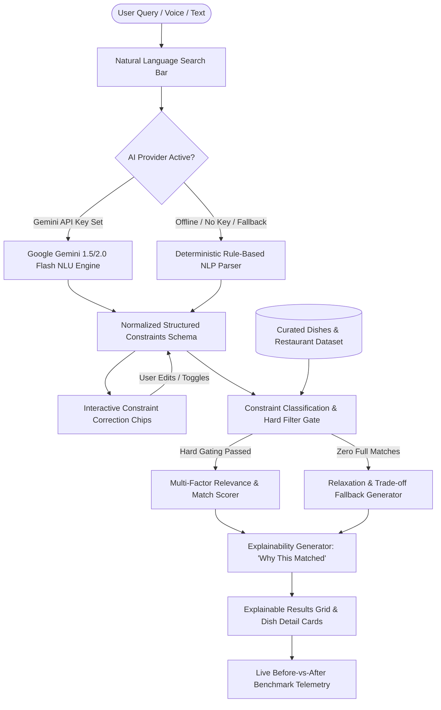

# AI Feature Rebuild: Natural-Language Food Discovery — Architecture

> **Technical architecture and system design for the Natural-Language Food Discovery engine, ranking pipeline, explainability generator, and interactive correction interface.**

---

## 1. System Overview

The Natural-Language Food Discovery platform operates as a modern client-centric Single Page Application (SPA) powered by Vite, with optional direct or proxied integration to the **Google Gemini API** (`gemini-1.5-flash` or `gemini-2.0-flash`) and an embedded **Deterministic Local NLP Parser** ensuring 100% offline and latency-free operation.



---

## 2. Constraint Taxonomy & Schema

To resolve ambiguities and prevent catastrophic failures (e.g., serving meat to a strict vegan or charging $40 when budget is $15), constraints are classified into **Hard** and **Soft** types.

### 2.1 Constraint Schema Definition

```typescript
interface ExtractedConstraints {
  rawQuery: string;
  hard: {
    maxBudget?: number;            // e.g. 20.00 (per dish or per order)
    budgetScope?: "per_item" | "total" | "per_person";
    groupSize?: number;            // e.g. 3 people
    dietaryRestrictions: string[]; // ["vegan", "gluten_free", "halal", "vegetarian", "dairy_free", "nut_free"]
    excludedAllergens: string[];   // ["peanuts", "shellfish", "dairy", "gluten"]
  };
  soft: {
    cuisines: string[];            // ["thai", "mexican", "japanese", "italian", "indian", "mediterranean"]
    mealType?: string;             // "lunch", "dinner", "breakfast", "late_night", "snack"
    targetDeliveryMaxMinutes?: number; // e.g. 30
    spicePreference?: "mild" | "medium" | "spicy" | "extra_spicy";
    cravings: string[];            // ["comfort", "healthy", "high_protein", "crispy", "soup", "bowl"]
    minRating?: number;            // e.g. 4.3
  };
  inferredConfidence: number;      // 0.0 to 1.0
  explanation: string;             // High-level interpretation summary
}
```

### 2.2 Hard vs Soft Constraint Matrix

| Constraint Category | Default Classification | Strictness Rule | Failure Handling |
| :--- | :--- | :--- | :--- |
| **Max Budget** | **Hard** | Item price $\le$ `maxBudget` | Dropped from primary results; shown in "Budget Relaxed" fallback if empty |
| **Dietary Restrictions** | **Hard** | Item must possess certified tag | Strictly excluded; never compromised |
| **Allergen Warnings** | **Hard** | Must NOT contain any specified allergen | Strictly excluded; zero tolerance |
| **Cuisine Type** | **Soft** (unless explicit) | Boosts score if matching; flexible | Partial matches ranked lower |
| **Delivery Speed** | **Soft** | Prep + Delivery $\le$ target minutes | Time difference penalizes score proportionally |
| **Sensory / Craving** | **Soft** | Keyword tag matches (protein, crispy, etc.) | High score bonus without gating |

---

## 3. Natural Language Understanding (NLU) Pipeline

The NLU system adopts a **dual-engine fail-safe architecture**:

### 3.1 Primary: Google Gemini API Engine
- **Model:** `gemini-1.5-flash` or `gemini-2.0-flash`.
- **System Prompt:** Instructs the model to return structured JSON matching the `ExtractedConstraints` schema without markdown wraps.
- **Few-Shot Examples:** Calibrated with 10 real-world complex conversational queries covering idioms, currencies, group splitting, and contradictory requests.

### 3.2 Secondary: Deterministic Local Rule-Based NLP Parser
- **Token Normalizer:** Lowercases, stems, extracts numeric values, cleans punctuation.
- **Budget Regex:** Matches `under $X`, `less than $X`, `max X dollars`, `cheap`, `$X each for Y people`.
- **Dietary Dictionary:** Matches multi-lingual and slang terms (e.g., `veg`, `plant-based`, `celiac`, `dairy-free`).
- **Cuisine & Craving Lexicon:** Maps terms like `"comforting"`, `"gym fuel"`, `"hangover cure"`, `"noodles"`, `"tacos"`.
- **Instant Response Time:** $< 2\text{ms}$ execution time, 0 network dependency.

---

## 4. Scoring, Ranking & Fallback Algorithm

### 4.1 Ranking Formula
For all items $i \in \text{CuratedDataset}$:

$$\text{Eligible}(i) = \mathbb{I}(\text{HardSatisfied}(i))$$

If $\text{Eligible}(i) = 1$:

$$\text{MatchScore}(i) = S_{\text{base}} + W_{\text{cuisine}} \cdot M_{\text{cuisine}} + W_{\text{speed}} \cdot M_{\text{speed}} + W_{\text{craving}} \cdot M_{\text{craving}} + W_{\text{rating}} \cdot M_{\text{rating}} + W_{\text{budget\_headroom}} \cdot M_{\text{budget}}$$

Where weights are normalized:
- $W_{\text{cuisine}} = 0.30$
- $W_{\text{craving}} = 0.25$
- $W_{\text{speed}} = 0.20$
- $W_{\text{rating}} = 0.15$
- $W_{\text{budget\_headroom}} = 0.10$

### 4.2 Transparent Match Explanation Breakdown
Each card receives a computed breakdown object:
```json
{
  "matchPercentage": 96,
  "satisfiedBadges": [
    {"label": "$15.50 (Under $18 budget)", "type": "success", "icon": "check-circle"},
    {"label": "100% Certified Vegan", "type": "success", "icon": "leaf"},
    {"label": "22 min delivery (Target < 30m)", "type": "success", "icon": "clock"},
    {"label": "High Protein (28g)", "type": "highlight", "icon": "zap"}
  ],
  "compromiseNotes": []
}
```

### 4.3 Fallback & Relaxation Resolver
When no items satisfy all hard constraints:
1. Identify the most restrictive constraint (typically tight budget with delivery speed or niche cuisine).
2. Relax the constraint slightly (e.g., raise budget by $+15\%$, or extend delivery radius by $+10\text{ mins}$).
3. Present results labeled: *"Zero exact matches for your combined constraints. Here are the closest options if you relax [Constraint Name]"*.

---

## 5. Curated Dataset Architecture

The dataset is stored in `src/data/foodDataset.js` and contains 50+ hand-crafted, realistic dishes across 16 authentic restaurants.

### 5.1 Dataset Schema
```typescript
interface FoodItem {
  id: string;
  name: string;
  restaurantId: string;
  restaurantName: string;
  cuisine: string;
  price: number;
  rating: number;
  reviewCount: number;
  deliveryTimeMin: number;
  deliveryTimeMax: number;
  deliveryFee: number;
  portionSize: "single" | "serves_2" | "family_share_4";
  dietary: ("vegan" | "vegetarian" | "gluten_free" | "halal" | "dairy_free" | "nut_free" | "keto")[];
  allergens: ("gluten" | "peanuts" | "tree_nuts" | "dairy" | "eggs" | "shellfish" | "soy")[];
  spiceLevel: 0 | 1 | 2 | 3; // 0=None, 1=Mild, 2=Medium, 3=Hot
  calories: number;
  proteinGrams: number;
  tags: string[]; // ["high_protein", "comfort", "crispy", "soup", "healthy", "bowl", "salad"]
  description: string;
  imageUrl: string;
}
```

---

## 6. Frontend Component Architecture

The interface uses modern Vanilla CSS with custom glassmorphism design tokens, dynamic animations, and modular ES6 components:

```
src/
├── index.html                 # Semantic HTML5 with SEO meta tags & fonts
├── style.css                  # Modern CSS design system, dark mode, tokens, animations
├── main.js                    # Application lifecycle coordinator & router
├── data/
│   ├── foodDataset.js         # Curated 50+ dish items & 16 restaurants
│   └── testQueries.js         # Canonical evaluation queries with ground truth
├── engine/
│   ├── nluParser.js           # Deterministic NLP parser & regex extractor
│   ├── geminiClient.js        # Google Gemini API connector with fallback
│   ├── matcher.js             # Hard gating & multi-factor scoring algorithm
│   └── explanation.js         # "Why this matched" breakdown generator
├── components/
│   ├── SearchHero.js          # Search input, voice/example pills, provider selector
│   ├── ConstraintChips.js     # Editable, toggleable constraint tags
│   ├── ResultsGrid.js         # Dynamic dish cards with satisfaction badges
│   ├── DishDetailModal.js     # Deep dive modal with ingredients & allergen checks
│   ├── FallbackBanner.js      # Smart constraint relaxation suggestions
│   └── BenchmarkModal.js      # Side-by-side Before (8-step filter) vs After (AI) simulator
└── utils/
    ├── storage.js             # LocalStorage state persistence
    └── metrics.js             # Live telemetry tracker (clicks, latency, match %)
```

---

## 7. Before vs After Workflow Simulation

To validate the product hypothesis for the portfolio case study, the app includes a **Workflow Benchmark Mode**:

| Attribute | Baseline (Conventional Food App) | Rebuilt Feature (Natural Language Search) |
| :--- | :--- | :--- |
| **Interaction Steps** | 8 to 12 modal clicks & dropdown scrolls | 1 natural language input or 1-click sample prompt |
| **Time to Match** | 180 – 240 seconds | 8 – 15 seconds ($>90\%$ reduction) |
| **Allergen Verification** | Manual menu inspection per restaurant | Automatic guaranteed dish-level gating |
| **Subjective Cravings** | Impossible to express | Directly mapped via semantic craving tags |
| **Query Refinement** | Deselect and reset entire filter trees | 1-click edit on individual constraint chips |

---

## 8. Technology Stack & Key Decisions

- **Bundler & Dev Server:** Vite (fast ESM, zero configuration overhead).
- **Styling:** Vanilla CSS with comprehensive CSS custom properties (design tokens, glassmorphism blur, responsive grid, dynamic hover states).
- **AI Processing:** Google Gemini API (`@google/generative-ai` / fetch client) + zero-latency local deterministic regex parser.
- **Portability:** 100% runnable in browser with no mandatory external database server setup, enabling immediate demonstration and hosting on GitHub Pages, Vercel, or Netlify.
